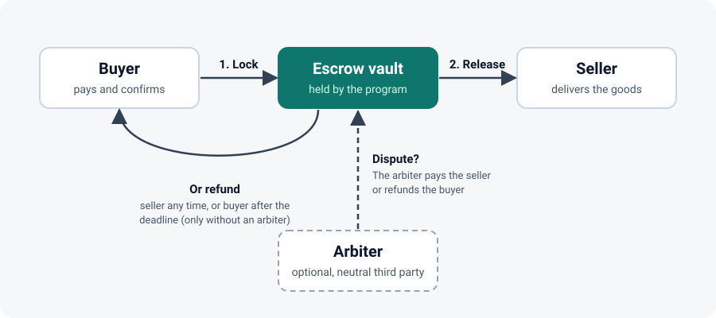
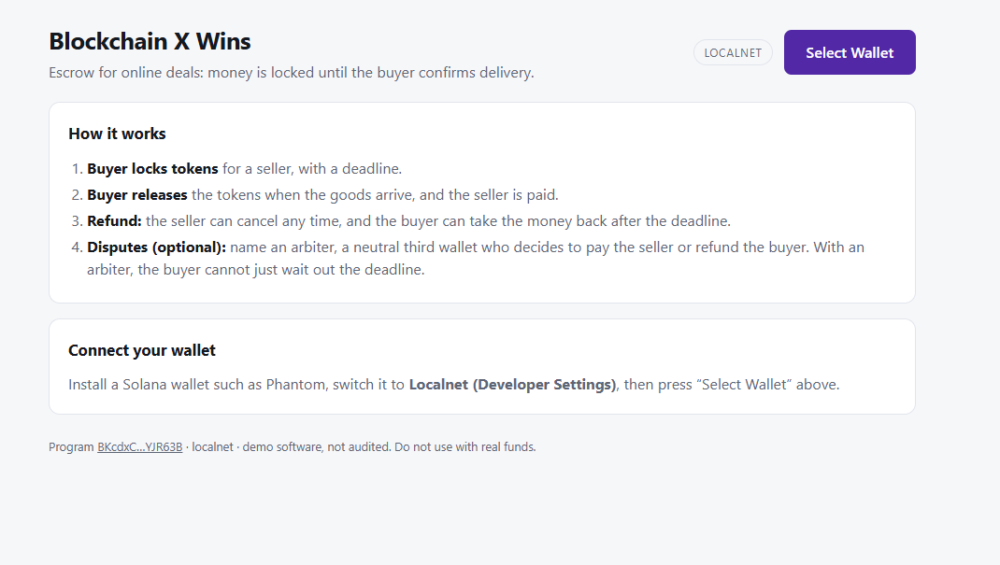

# BLOCKCHAIN X WINS

[](https://github.com/Faafo1/blockchain-x-wins/actions/workflows/ci.yml)

A Solana **escrow** built with [Anchor](https://www.anchor-lang.com/). A buyer locks SPL tokens (for example USDC) for a seller, and the funds are released only when the buyer confirms delivery. It solves the trust problem in online selling: the seller knows the money is locked, and the buyer knows it is not paid until the goods arrive. An optional **arbiter** can settle disputes.



<!-- To add a screenshot of the app: save it as docs/app.png, then replace this line with:  -->

## Features

- Lock tokens for a seller with a deadline.
- Release to the seller, or refund the buyer.
- Optional arbiter who can pay the seller or refund the buyer.
- A React web app with wallet connect (Phantom and other Solana wallets).
- 14 automated tests, run on every push by GitHub Actions.

## Status

| Part | State |
|------|-------|
| On-chain program and tests | Done. All tests pass locally and in CI |
| Web app | Done. Tested against a local test network |
| Devnet deployment | Not yet (waiting on test SOL) |
| Security audit | Not done. Do not use with real funds |

## How it works

| Instruction | Who calls it | What happens |
|-------------|--------------|--------------|
| `create(escrow_id, amount, deadline, arbiter)` | Buyer | Locks `amount` tokens in a program-owned vault for the seller. `arbiter` is optional (the all-zero key means none) |
| `release` | Buyer | Confirms delivery: tokens go to the seller, escrow closes |
| `refund` | Seller (any time) or buyer (after `deadline`, only if there is no arbiter) | Tokens go back to the buyer, escrow closes |
| `resolve(pay_seller)` | Arbiter | Settles a dispute: pays the seller or refunds the buyer |

Safety rules built in:
- Zero amounts and deadlines in the past are rejected.
- Only the buyer can release funds.
- Without an arbiter, the buyer cannot pull funds back before the deadline, so the seller is protected. The seller can always cancel.
- With an arbiter, the buyer cannot reclaim by waiting out the deadline: only the buyer (release), the seller (cancel) or the arbiter (decide) can move the funds. The arbiter cannot be the buyer or the seller.
- Strangers cannot refund, release or resolve.
- The vault is controlled by the program (a PDA), not by any person.

**Trade-off:** if an arbiter is named and then disappears, and the buyer and seller never agree, the funds stay locked. Choose an arbiter both sides trust.

**Not included yet:** partial releases and arbiter fees.

## Project layout

```
programs/escrow/src/lib.rs   On-chain program (Rust)
tests/escrow.ts              TypeScript tests
app/                         Web app (React + Vite), see app/README.md
docs/flow.svg                Diagram used in this README
Anchor.toml                  Anchor config (localnet + devnet)
Cargo.lock                   Pinned crate versions (see the note below)
.github/workflows/ci.yml     GitHub Actions: format, build, tests, web app build
```

## Try it yourself

### 1. Prerequisites

[Rust](https://rustup.rs), the [Solana CLI](https://solana.com/docs/intro/installation), [Anchor](https://www.anchor-lang.com/docs/installation) 0.31.x, Node.js 22 and Yarn. On Windows, use WSL (Ubuntu).

### 2. Run the tests

```bash
yarn install
solana-keygen new          # creates your dev wallet; keep it OUT of git
anchor test                # builds, starts a local network and runs 14 tests
```

### 3. Run the web app on a local network

Terminal 1 (repo root): start a local network with the program loaded.

```bash
anchor build
solana-test-validator --reset \
  --bpf-program $(solana address -k target/deploy/escrow-keypair.json) \
  target/deploy/escrow.so
```

Terminal 2: start the app.

```bash
cd app
npm install
npm run sync-idl
npm run dev
```

Open http://localhost:5173 and switch your wallet (for example Phantom) to its local test network setting. The app has buttons to get free test SOL and create a test token, so no faucet is needed. Full walkthrough: [app/README.md](app/README.md).

### Your own program id

The program id in `programs/escrow/src/lib.rs` belongs to the author's key. To run your own copy, generate your own key with `anchor build`, then run `anchor keys sync` and build again.

## Deploy to Devnet

```bash
solana config set --url devnet
# get test SOL (about 2) from https://faucet.solana.com, then:
anchor deploy --provider.cluster devnet
```

The command-line `solana airdrop` is often closed on Devnet, so use the web faucet. Only move to mainnet after the program has been professionally reviewed. Mainnet uses real money.

## Notes

- **Do not delete `Cargo.lock`.** Solana's build tool uses an older Cargo than current Rust, and the lockfile pins crate versions it can read. Without it, `anchor build` can fail with `feature edition2024 is required`.
- Never commit keypair files or `.env` files (the `.gitignore` blocks common ones).
- This is a learning project. Get a professional audit before holding real user funds.

## License

MIT
